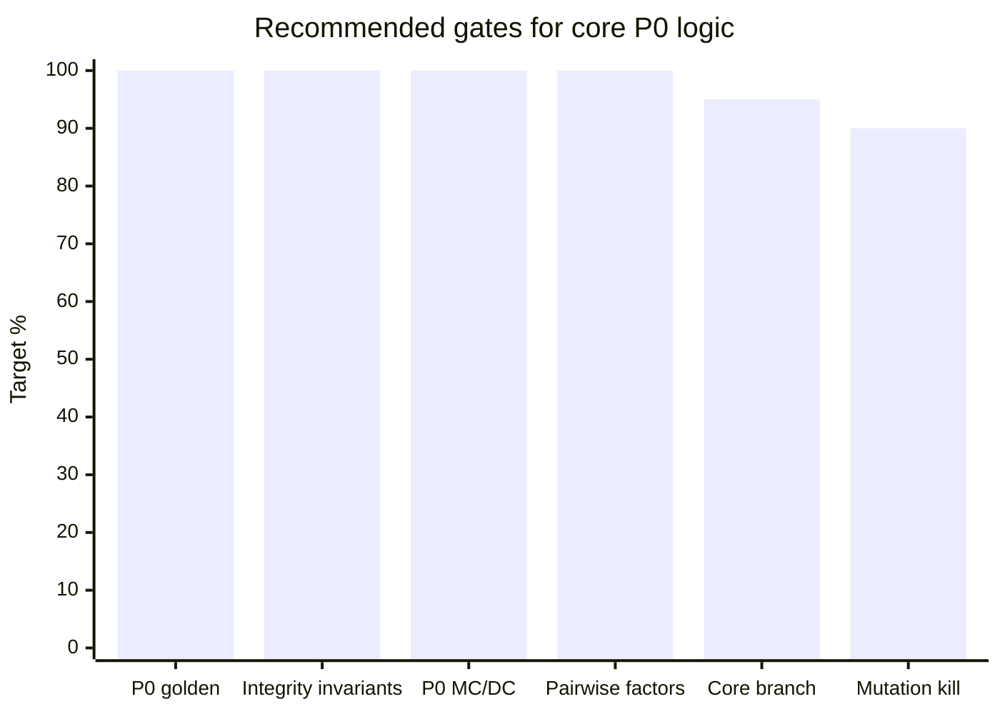
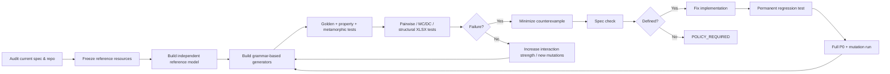

# Reliability Research for a Russian Contact XLSX Normalizer

## Executive summary

The current project is already beyond a basic “clean spreadsheet” task. Based on the supplied research, experiment plan, and the repository excerpts, the implementation now has explicit handling for phone context, date ambiguity, name-role evidence, audit preservation, duplicate linkage, XLSX cell metadata, and generated QA. The existing gap analysis found several real classes of silent corruption—such as stripping too many leading `8`s from Russian phone numbers, interpreting a Cyrillic `О` as harmless phone noise, conflating Excel serials 59 and 60, overusing `str.title()`, and losing data because of illegal XML characters. fileciteturn0file0 The experiment plan also correctly separates library observations from the project's acceptance rules and includes phone differential testing, date parsing, Excel epochs, Unicode, deduplication, and raw-value preservation. fileciteturn0file1

The main conclusion of this research is that **Codex should stop thinking in terms of “more regexes” and start treating the normalizer as a small verified data-transformation system**. The strongest reliability architecture is:

> **Specification → independent reference model → deterministic grammar-based generators → property/metamorphic tests → combinatorial coverage → structural XLSX fuzzing → mutation testing → formal invariants → regression corpus.**

No single external library should become the acceptance oracle. CLDR knows locale data but not this project's accepted grammar; `dateparser` and `python-dateutil` intentionally parse substantially more date language than this specification; libphonenumber knows allocation and numbering metadata that this project intentionally does not use as an acceptance gate; name dictionaries are incomplete and overlap between first names, surnames, and patronymics. citeturn14search2turn14search6turn21search2turn15search2

The project should therefore use public resources in three distinct roles:

1. **Normative/reference data:** Unicode UCD/UTS #39, CLDR locale data, OOXML/Excel behavior.
2. **Differential adversaries:** dateparser, dateutil, libphonenumber, python-phonenumbers.
3. **Evidence corpora:** russiannames, NEN names, Russian name wordlists.

That separation is essential. A third-party parser saying “valid” is a reason to create a test—not necessarily a reason for this software to accept the input.

The highest-value P0 work for Codex is now:

- build a completely independent reference implementation for the narrow approved grammar;
- make every P0 normalizer decision have executable specification examples and MC/DC vectors;
- model every physical input row with an immutable `row_id`;
- prove that missing/invalid phones never deduplicate together;
- prove first-physical-row representative selection;
- prove raw-value preservation independently of the generated report;
- test both semantic XLSX values and raw OOXML;
- run Unicode and XLSX structural mutations, not just dirty strings;
- make every Hypothesis failure permanent via an explicit regression case;
- mutation-test `phone.py`, `dates.py`, `name_roles.py`, `reader.py`, `invariants.py`;
- treat all unspecified semantics as `POLICY_REQUIRED`, not as opportunities for Codex to invent behavior.

The already reported “32 minimal resource examples pass” is useful regression evidence, but it is **not evidence that the normalizer is generally correct**. In particular, the supplied `tools/run_qa.py` excerpt explicitly acknowledges that subprocess CLI execution is not included in parent-process coverage; structural XLSX combinations, name-lexicon classification errors, and higher-order interactions can therefore remain invisible even while the current suite is green.

A further important finding is that the old gap report was written against specification 1.0, while the repository excerpt now reports specification 1.4. Therefore **Codex must not copy old expected statuses blindly**. Every historical GAP should be re-bound to the current `docs/SPECIFICATION.md` before becoming a golden test. fileciteturn0file0

## Evidence baseline and what should count as truth

The best assurance model has four levels of authority.

**The current specification is level zero.** `docs/SPECIFICATION.md`, approved `DEC-*` decisions, and the current versioned scenario catalog determine what this program is allowed to accept and transform. External libraries cannot silently expand that language.

**An independent reference model is level one.** It should intentionally be simpler than production and must not import production regexes, extraction helpers, or role-classification routines. The production implementation and reference model should fail differently when either contains a defect.

**External public resources are level two.** They generate cases, supply Unicode/locale facts, or flag disagreements. They do not override the spec.

**Generated random/fuzz inputs are level three.** They explore state space, but their expected result must come from a property, reference model, or explicit policy—not from whatever the production parser currently returns.

This matters particularly for dates. Unicode CLDR is the authoritative locale-data project, and its Russian locale XML contains Russian locale/date vocabulary. However, CLDR's current `main` branch identifies itself as a preliminary CLDR 49 state and explicitly says it is not recommended for production use; therefore CI should pin a release or commit hash rather than download mutable `main`. The CLDR JSON project also states that XML is the official source and JSON is generated from it. citeturn14search0turn14search1turn14search2

It matters equally for phones. libphonenumber can parse, format, test possibility and validity, classify types, and find phone numbers in surrounding text. That makes it an excellent **differential adversary**. It is not the project's oracle if the project's contract deliberately accepts any structurally valid `+7` plus ten digits rather than only currently allocated Russian numbers. citeturn15search2turn15search10

And it matters most for names. `russiannames` itself documents that rare names/surnames/midnames may fail to parse, even though its bundled datasets are large: the current repository describes roughly 32,134 first names, 48,274 middle names and 375,449 surnames. This is precisely why dictionary absence must mean **UNKNOWN**, not “not a real name.” citeturn15search1

For this project, the question should **not** be “is this a Russian person/name?” It should be:

> **Does the supplied field contain sufficiently strong evidence for a personal first-name component, and can we establish its role without guessing?**

Nationality, ethnic origin, Cyrillic script, and FIRST/LAST/PATRONYMIC role are four different concepts.

A robust role model for a token `t` is therefore:

\[
L(t) \subseteq \{FIRST, LAST, PATRONYMIC\}
\]

Then:

- `L(t) = {FIRST}` → positive first-name evidence.
- `L(t) = {LAST}` → surname-only evidence.
- `L(t) = {PATRONYMIC}` → patronymic-only evidence.
- `|L(t)| > 1` → `AMBIGUOUS`.
- `L(t) = ∅` → `UNKNOWN`.

For a multi-token field, enumerate plausible role assignments. Accept a role decomposition only when the constraints leave exactly one acceptable assignment containing a first name; otherwise abstain. This is much safer than “ends with `-ов` → surname” or “exists in a first-name dictionary → FIRST_NAME.”

The existing `normalizer/name_roles.py` excerpt is already moving in exactly this direction: role sets, explicit ambiguous tokens, multiple lexicons, and abstention. Codex should strengthen this architecture rather than replace it with one black-box parser.

## Authoritative resources and reference datasets

### Recommended resource inventory

| Dataset/tool | Exact URL or raw resource | Use in this project | License / reuse status |
|---|---|---|---|
| Unicode CLDR Russian locale | `https://raw.githubusercontent.com/unicode-org/cldr/main/common/main/ru.xml` | Russian month names, abbreviations, locale patterns; generate date corpus, **not** automatically widen accepted grammar | Unicode-3.0 terms in current CLDR files. Pin release/commit, not mutable `main`. citeturn14search1turn14search2 |
| CLDR JSON | `https://github.com/unicode-org/cldr-json` | Convenient generated JSON representation if needed by bootstrap tooling | Unicode project license; XML remains official source. citeturn14search0 |
| dateparser tests | `https://raw.githubusercontent.com/scrapinghub/dateparser/master/tests/test_date_parser.py` | Mine accepted human-language dates and turn unsupported ones into negative/differential cases | BSD-3-Clause. Dateparser deliberately supports broad absolute, relative, timezone and multilingual parsing. citeturn14search6turn19view1 |
| dateparser test corpus | `https://raw.githubusercontent.com/scrapinghub/dateparser/master/tests/test_date_data.py` | Additional date mutation/corpus source | BSD-3-Clause. citeturn14search6turn19view1 |
| python-dateutil parser tests | `https://raw.githubusercontent.com/dateutil/dateutil/master/tests/test_parser.py` | Excellent corpus of strings a flexible parser may interpret; differential tests only | BSD-3-Clause / Apache-2.0 depending on contribution provenance. citeturn19view0turn21search2 |
| libphonenumber metadata | `https://raw.githubusercontent.com/google/libphonenumber/master/resources/PhoneNumberMetadata.xml` | Generate real numbering-pattern examples and find disagreements with structural project rules | Apache-2.0. citeturn15search2turn15search10 |
| libphonenumber metadata schema | `https://raw.githubusercontent.com/google/libphonenumber/master/resources/phonemetadata.proto` | Understand exact semantics of XML metadata fields | Apache-2.0; proto explicitly corresponds to metadata XML fields. citeturn15search7 |
| libphonenumber falsehoods | `https://raw.githubusercontent.com/google/libphonenumber/master/FALSEHOODS.md` | Source of anti-assumptions and adversarial phone cases | Apache-2.0 repository. citeturn15search2 |
| libphonenumber FAQ | `https://raw.githubusercontent.com/google/libphonenumber/master/FAQ.md` | Differential parsing pitfalls | Apache-2.0 repository. citeturn15search2 |
| python-phonenumbers | `https://github.com/daviddrysdale/python-phonenumbers` | Python differential implementation using libphonenumber semantics; matcher corpus | Apache-2.0. citeturn21search5turn21search11 |
| russiannames | `https://github.com/datacoon/russiannames` | FIRST/LAST/PATRONYMIC evidence and full-name role comparison | BSD-3-Clause. Repository documents bundled names, surnames and midnames datasets and parsing limitations. citeturn15search1 |
| sorokinpf first names | `https://raw.githubusercontent.com/sorokinpf/russian_names/master/names.jsonl` | Frequency-oriented first-name evidence | No explicit license surfaced in the repository listing; use as research/evidence only until reuse rights are clarified. citeturn15search3 |
| sorokinpf patronymics | `https://raw.githubusercontent.com/sorokinpf/russian_names/master/midnames.jsonl` | Patronymic evidence and role collision tests | Same unresolved license status. citeturn15search3 |
| sorokinpf surnames | `https://raw.githubusercontent.com/sorokinpf/russian_names/master/surnames.jsonl` | Surname evidence and FIRST/LAST collisions | Same unresolved license status. citeturn15search3 |
| NEN names | `https://raw.githubusercontent.com/mdanina/nen-imena-dataset/main/data/names.json` | High-quality curated first-name evidence, short forms, gender metadata, rare-name corpus | CC BY 4.0; 1,551 curated names in the current dataset. citeturn15search0 |
| Unicode confusables | `https://www.unicode.org/Public/18.0.0/security/confusables.txt` | Generate Latin/Cyrillic and look-alike attacks | Unicode Terms / Unicode data license. Unicode 18.0 security data is current in the 2026 UCD. citeturn16search1turn16search20 |
| Unicode normalization tests | `https://www.unicode.org/Public/18.0.0/ucd/NormalizationTest.txt` | Generate NFC/NFD/NFKC/NFKD equivalence tests | Unicode data terms. citeturn16search6 |
| Unicode derived properties | `https://www.unicode.org/Public/18.0.0/ucd/DerivedCoreProperties.txt` | Generate Default_Ignorable_Code_Point and script/property edge cases | Unicode data terms. citeturn16search6 |
| Hypothesis | `https://hypothesis.readthedocs.io/` | Property/state-machine generation, shrinking, replay | MPL-2.0. citeturn17search2turn20search2 |
| openpyxl | `https://pypi.org/project/openpyxl/` | Build/read normal workbook variants | MIT. citeturn21search1 |
| XlsxWriter | `https://pypi.org/project/XlsxWriter/` | Independently construct formula/string/style variants | BSD-2-Clause. citeturn20search0 |
| icontract | `https://pypi.org/project/icontract/` | Runtime pre/postconditions around pure core functions | MIT. citeturn21search0 |
| Z3 | `https://microsoft.github.io/z3guide/programming/Z3%20Python/Introduction/` | Exhaust finite policy/decision models and prove absence of small counterexamples | `z3-solver` Python binding documented by the Z3 project. citeturn18search4 |

All remotely fetched resources used in CI should be **snapshotted and content-addressed**. A manifest should record source URL, upstream commit/release, SHA-256, acquisition date, license, and the preprocessing code version. Tests should subsequently work without network access. This avoids upstream changes silently changing acceptance results.

### Date corpus: what Codex should extract

CLDR is particularly useful for generating Russian month lexemes: format versus stand-alone forms, abbreviated versus full forms, and locale patterns. But the set accepted by the application must remain whatever the current specification explicitly approves. CLDR should answer “what real locale variants exist?”, not “what must our parser accept?” citeturn14search0turn14search1

`dateparser` and `python-dateutil` should be mined in the opposite direction. Both are flexible general date parsers; dateparser explicitly supports relative dates, more than 200 language locales, time zones and date search in text. Therefore every string they accept outside the narrow project grammar is potentially a **negative regression case**, not a feature request. citeturn14search6turn21search2

Recommended differential harness:

```text
raw input
   │
   ├── project reference grammar ──> ACCEPT / REJECT / POLICY_REQUIRED
   ├── production dates.py        ──> actual
   ├── dateparser                 ──> diagnostic only
   └── dateutil.parser            ──> diagnostic only
```

The interesting queue is:

```text
reference rejects AND external parser accepts
```

because this is where a future developer is most likely to introduce a false-positive “improvement.”

Excel date handling deserves its own reference model. OOXML does not simply store a universal “date object”: numeric/date values can depend on cell values and styles, and cells may be numeric, shared-string, inline-string, Boolean, error, formula-related, and so on. Microsoft documents that shared strings require a shared-string-table lookup, while formulas can carry a last-calculated value. citeturn16search5turn16search11turn16search14

Your prior experiment is especially important: in the tested stack, Excel serial `59` and `60` both surfaced as `1900-02-28` through the high-level conversion path. Thus raw XML inspection is necessary if the specification distinguishes serial 60 as the fictitious Excel leap day. fileciteturn0file0

Codex should therefore test at least:

```text
epoch = 1900 / 1904
storage = numeric / text / inlineStr / sharedString / formula
style = General / date-looking / time-looking / custom
serial = 0, 1, 59, 60, 61, fractional-day values
```

and never decide “numeric cell = date” solely because its magnitude resembles a contemporary Excel date.

### Phones: reference versus project acceptance

The safest canonical output assertion is deliberately boring:

```python
CANONICAL_RU_PHONE = re.compile(r"\+7[0-9]{10}\Z")
```

or, even better:

```python
assert re.fullmatch(r"\+7[0-9]{10}", canonical)
```

Use `[0-9]`, **not `\d`**, when the assertion specifically means ASCII output digits. Python-style Unicode digit classes can otherwise make the canonical language broader than intended.

For raw values, regex should only locate a **candidate**, never decide that the whole cell is semantically safe. A useful candidate finder is something like:

```python
PHONE_CANDIDATE = re.compile(
    r"(?<![0-9])(?:\+7|7|8)(?:[ \t().-]*[0-9]){10}(?![0-9])"
)
```

but acceptance must subsequently verify the entire approved context grammar. This prevents the classic anti-pattern:

```python
digits = re.sub(r"\D", "", entire_cell)
```

which can silently turn a damaged number, time, order number or second phone into a plausible different telephone number. Your existing gap research already demonstrated such a failure with Cyrillic `О`. fileciteturn0file0

Where the specification explicitly allows Unicode decimal digits, map only Unicode **decimal** characters (`Nd`) via `unicodedata.decimal()`. Do not generalize this to every character for which `isdigit()` happens to be true.

libphonenumber's metadata should be used for three things: generating legitimate formatting diversity, checking whether the production parser behaves unexpectedly on real numbering patterns, and producing examples around `+7`. It should **not** call `is_valid_number()` as a production gate unless the specification changes, because libphonenumber's validity semantics are stronger than this project's structural semantics. Google explicitly distinguishes “possible” from fully “valid” numbers based on numbering metadata. citeturn15search2

### Names: a hybrid evidence model

The recommended architecture is:

```text
Unicode/script validation
        ↓
tokenization
        ↓
exact role lexicons
        ↓
role-set intersections
        ↓
sequence constraints
        ↓
optional probabilistic ranking
        ↓
FIRST / LAST / PATRONYMIC / FULL_NAME
        or
AMBIGUOUS / UNKNOWN
```

`russiannames` is valuable as a strong external comparison because it explicitly parses first names, surnames and middle names and supports multiple full-name orders, but its own documentation says rare entries may fail. citeturn15search1 NEN gives a smaller curated first-name list with short forms, which is especially useful for cases such as `Саша`; the sorokinpf resources separate first names, middle names and surnames and can expose role overlap, although their reuse license needs clarification before bundling. citeturn15search0turn15search3

The strongest approach is **lexicon-first with abstention**, not “probabilistic classifier decides the truth.” A probabilistic layer can rank competing assignments:

\[
P(role_i \mid token_i,\ position,\ suffix,\ neighboring\ roles)
\]

but automatic normalization should require either an unambiguous rule or an explicitly approved confidence policy. Otherwise the model should return `AMBIGUOUS`/`UNKNOWN`.

For example:

| Input | Evidence model |
|---|---|
| `Андрей` | FIRST strongly supported |
| `Волков` | LAST strongly supported |
| `Андреевич` | PATRONYMIC strongly supported |
| `Волков Егор` | unique LAST + FIRST assignment |
| `Ирина Львовна` | unique FIRST + PATRONYMIC assignment |
| `Павлов Андрей` | unique LAST + FIRST assignment |
| `Ким` | potentially multiple roles → abstain |
| `Али` | potentially ambiguous → abstain |
| `Саша` | short-form FIRST evidence, but policy determines whether short forms count |
| rare absent name | UNKNOWN, **not invalid person** |
| `Andrey` | script/language policy question, not proof of “not a name” |
| `Андрeй` (`e` Latin) | mixed-script evidence; never silently repair |

Do not infer “Russian-ness,” ethnicity or nationality as an acceptance condition. The contact field's business question is whether a first-name component can be identified safely.

### Unicode and XLSX are first-class attack surfaces

As of the current Unicode data directory, Unicode 18.0 security resources include `confusables.txt`, and the UCD supplies derived character properties and normalization test material. UTS #39 specifically defines security data for confusable/identifier processing. citeturn16search1turn16search6turn16search20

Codex should automatically inject at least this set:

```text
U+00AD  SOFT HYPHEN
U+00A0  NO-BREAK SPACE
U+2009  THIN SPACE
U+200B  ZERO WIDTH SPACE
U+200C  ZERO WIDTH NON-JOINER
U+200D  ZERO WIDTH JOINER
U+200E  LEFT-TO-RIGHT MARK
U+200F  RIGHT-TO-LEFT MARK
U+202A  LEFT-TO-RIGHT EMBEDDING
U+202B  RIGHT-TO-LEFT EMBEDDING
U+202D  LEFT-TO-RIGHT OVERRIDE
U+202E  RIGHT-TO-LEFT OVERRIDE
U+202F  NARROW NO-BREAK SPACE
U+2060  WORD JOINER
U+2066  LEFT-TO-RIGHT ISOLATE
U+2067  RIGHT-TO-LEFT ISOLATE
U+2069  POP DIRECTIONAL ISOLATE
U+FEFF  ZERO WIDTH NO-BREAK SPACE / BOM
U+FE00..U+FE0F variation selectors
```

Add confusable pairs such as:

```text
Latin a / Cyrillic а
Latin e / Cyrillic е
Latin o / Cyrillic о
Latin p / Cyrillic р
Latin c / Cyrillic с
Latin x / Cyrillic х
Latin y / Cyrillic у

0 / O / О
1 / l / I / І
```

These should almost never be **automatically substituted**. Their value is in detecting that a string which looks harmless to a human is not the same code-point sequence.

For normalization, test all four Unicode normalization forms using `NormalizationTest.txt`, but production-name normalization should use only the explicitly approved form—currently NFC according to the supplied project context. NFKC should not be introduced just because it makes tests convenient: compatibility normalization has broader semantics than canonical composition.

For XLSX, remember that the file is an OOXML package, and the same visible cell string can be represented through a shared-string table or inline string. Formulas may have cached values; external readers can expose cached results differently; shared strings may contain rich-text runs. Microsoft's Open XML documentation explicitly distinguishes shared strings, inline strings and formula cached values. citeturn16search11turn16search14

Therefore openpyxl-generated workbooks are not enough. Use:

- `openpyxl` for normal semantic variants;
- XlsxWriter as an independent writer;
- Python `zipfile` plus direct XML edits for malformed package cases;
- raw XML inspection for Excel serial 60, styles, formula tags, shared-string indices and workbook epoch;
- truncation and CRC corruption at ZIP level.

XlsxWriter is particularly useful as a second producer because it is independent of openpyxl. citeturn20search0turn21search1

## Assurance model, mathematical invariants, and test methodology

### Model the normalizer as partial canonicalization

Do not conceptualize a field normalizer as:

\[
string \rightarrow string
\]

Model it as:

\[
N(x) \rightarrow
\begin{cases}
Success(c,\ evidence)\\
Problem(code,\ evidence)\\
PolicyRequired(evidence)
\end{cases}
\]

where `x` contains **both value and type/metadata**.

For phones:

\[
C_p(x) \in L_p \cup \{\bot\}
\]

where

\[
L_p = \{ +7d_1d_2...d_{10} \mid d_i \in \{0,\ldots,9\}\}
\]

and `⊥` means no safe canonical phone.

This produces a crucial deduplication relation:

\[
r_i \sim r_j
\iff
C_p(r_i.phone) \neq \bot
\land
C_p(r_i.phone)=C_p(r_j.phone)
\]

This definition **mathematically prevents all missing phones from becoming one duplicate group**.

Representative selection should be explicitly:

\[
rep(G)=
\arg\min_{r \in G} physical\_input\_order(r)
\]

if that remains the current specification rule.

The following should be P0 invariants.

**Canonical language invariant**

```text
phone success => fullmatch(r"\+7[0-9]{10}", canonical_phone)
date success  => canonical == YYYY-MM-DD and datetime.date(...) exists
```

**Preservation invariant**

For every physical input row:

\[
raw_{recoverable}(row\_id) = raw_{input}(row\_id)
\]

including sufficient type metadata to distinguish semantically important cases such as a numeric cell versus textual `"89174005219.0"`.

**Inventory invariant**

```text
set(input_row_ids) == set(original_audit_row_ids)
len(input_row_ids) == len(original_audit_row_ids)
```

Do **not** derive preservation by summing rows across `Данные`, `Проблемы`, and audit sheets: one physical input can legitimately appear in several logical views.

**Dedup partition invariant**

```text
every successful canonical phone belongs to exactly one phone group
invalid/missing phone belongs to no canonical-phone group
```

**Representative invariant**

```text
representative(group) == first physical input member of that group
```

**Idempotence**

For successful canonical values:

\[
N(N(x).canonical).canonical = N(x).canonical
\]

Idempotence should hold independently for phone/date/name normalization where applicable.

**Determinism**

Given identical source bytes, specification version, resource bundle and program version:

\[
Run(x) = Run(x)
\]

at the logical output level. Byte-for-byte XLSX equality is not required because packaging metadata may vary; compare the defined semantic/audit representation.

**Non-interference**

Changing `Источник` must not change normalized phone, name, or date.

Adding a row whose successful canonical phone is outside every existing phone group must not modify canonical field values for existing rows.

**Order sensitivity is explicit, not accidental.** Reordering unique-phone rows should not change the set of canonical results. Reordering members inside one duplicate group may change the representative **only according to the first-row rule**.

**Transformation-witness invariant**

Every changed field should have a machine-readable justification such as:

```text
row_id
field
old value
new value
rule_id
evidence/details
```

The current report architecture already appears to expose this concept through `FIELD_CHANGE`, `NAME_COMPONENTS_EXTRACTED`, `DATE_ORDER_RESOLVED`, and related audit kinds in the supplied excerpt.

### Specification-as-executable plus a separate reference model

Golden tests are the first layer:

```python
Case(
    id="P_xxx",
    raw=...,
    input_type=...,
    expected_status=...,
    expected_value=...,
    expected_issue=...,
    rule_id="..."
)
```

The expected value must be written before the implementation change and must never be calculated by calling the production normalizer.

The second layer should be a separate `tests/reference_model.py`. It should be intentionally unsophisticated:

- phone: finite grammar/state machine;
- date: explicit approved alternatives → component tuple → `datetime.date`;
- names: frozen role sets + combinatorial role assignment;
- dedup: a plain dictionary keyed by canonical phone;
- row inventory: a list/set model.

Do not import `normalizer.phone`, `normalizer.dates`, or `normalizer.name_roles` from the reference model.

### Property-based and stateful testing

Hypothesis is particularly well suited because it generates and shrinks failures; its state-machine framework can execute operation sequences while checking invariants after every state transition. Hypothesis also saves failures to its example database, but its documentation explicitly warns that the database is a cache rather than something correctness should depend on; discovered critical cases should become explicit examples/regression fixtures. citeturn17search2turn17search7turn17search9turn17search10

Recommended strategies:

```text
phone_nsn()
    exactly 10 ASCII digits

canonical_phone()
    "+7" + phone_nsn()

phone_rendering()
    clean phone
    + approved prefix form
    + approved separators
    + approved context
    + controlled mutation(s)

valid_date()
    st.dates(...)

approved_date_rendering()
    date -> exactly one approved grammar variant

invalid_calendar_date()
    valid year + month/day deliberately outside datetime.date domain

name_token(role)
    sampled from pinned role lexicon

full_name()
    construct supported role ordering

unicode_mutation()
    insert one code point from pinned attack alphabet

xlsx_configuration()
    product of cell type / storage / style / epoch /
    formula / visibility / merge / shared-string mode
```

Use **construct → mutate**, rather than random garbage. Random garbage mostly confirms that the parser rejects garbage. Controlled mutations reach boundaries around legitimate inputs.

For stateful testing, model operations such as:

```text
create workbook
add unique row
add duplicate row
add malformed row
change source
save/reopen
normalize
read result
normalize result again
reorder input
```

and assert inventory/dedup/idempotence invariants after every normalization.

### Metamorphic tests

These are especially valuable when an exact expected output is expensive to enumerate.

Examples:

```text
canonical phone
  + allowed spaces
  + allowed parentheses
  + allowed hyphens
=> same canonical phone
```

```text
valid date
  rendered with any approved date grammar
=> same YYYY-MM-DD
```

```text
name in NFC
  converted to NFD
  then processed according to approved NFC rule
=> same processed-name comparison key
```

```text
dataset D + unrelated valid row r
=> existing canonical field values unchanged
```

```text
dataset D + duplicate appended to an existing phone group
=> representative unchanged
```

```text
normalizer(normalizer(canonical))
=> canonical
```

Also create **negative metamorphic operators**: replacing a digit with Cyrillic `О`, inserting an unapproved invisible character, adding an 11th national digit, or turning one date into two dates must not accidentally remain a plain successful normalization.

### Combinatorial testing

NIST's ACTS work formalizes t-way covering arrays: rather than exhaust the Cartesian product, a covering array ensures every t-way combination of factor values appears. NIST notes that low-order parameter interactions explain many defects and provides ACTS and coverage methods for this purpose. citeturn16search0turn16search3turn16search8

Define factors such as:

```text
phone_format:
  canonical / national8 / bare7 / punctuation / invalid / missing

phone_context:
  none / allowed_comment / extension / second_phone / identifier_noise

date_storage:
  text / numeric / datetime / formula / missing

date_grammar:
  ISO / DMY-dot / DMY-slash / Russian-month / invalid / serial

name_role:
  first / last / patronymic / full / ambiguous / unknown / mixed-script

unicode:
  none / NFC-NFD / confusable / default-ignorable / bidi / exotic-space

xlsx_string_storage:
  sharedString / inlineStr / direct string

epoch:
  1900 / 1904

duplicate_topology:
  none / duplicate / conflict / missing-phone-group

row_position:
  first / middle / last / hidden
```

Start with 100% **pairwise coverage** of declared values. Use 3-way combinations for the highest-risk clusters:

```text
phone × Unicode × duplicate topology
date × Excel type × epoch
name × Unicode × role ambiguity
cell storage × formula state × output preservation
```

### MC/DC for P0 decisions

MC/DC requires each atomic Boolean condition in a decision to independently demonstrate its effect on the outcome. NASA's tutorial and handbook describe this stronger structural criterion for critical decision logic. The project is not claiming aerospace certification; the idea is useful here because the phone/date/name gatekeepers contain exactly the sort of compound predicates where conventional branch coverage can hide untested conditions. citeturn18search10turn18search2

For example, if phone acceptance contains:

```python
accepted = (
    candidate_count == 1
    and prefix_supported
    and digit_count == expected
    and context_safe
    and not forbidden_identifier
)
```

write an MC/DC table where each condition independently flips `accepted`.

Do this manually for every P0 Boolean decision in:

```text
phone.py
dates.py
name_roles.py
reader.py
invariants.py
```

Coverage.py's branch mode records whether distinct branch destinations were executed, which is useful but is not equivalent to MC/DC. citeturn17search8

### Mutation testing

A green test suite can still be weak. `mutmut` deliberately makes small source changes such as changing comparison operators or numeric constants so the test suite can demonstrate that it notices incorrect implementations. citeturn18search1turn18search8

High-value custom mutation expectations are:

```text
remove exactly-one-leading-8 logic
replace it with lstrip("8")

change [0-9] to \d

remove fullmatch/end anchor

drop calendar validation

swap day and month

treat serial 60 as normal

change first duplicate representative to last

allow missing phones to share key None

remove NFC comparison normalization

drop mixed-script detection

remove raw-value audit write

change FIELD_CHANGE to no-op

read workbook with data_only=True

treat formula cached result as input truth

skip hidden rows

truncate audit value rather than chunk it
```

Every such mutation surviving the suite is a test-design defect.

### Formal methods: use them narrowly

`icontract` supports executable preconditions/postconditions and is an appropriate way to state pure core invariants. citeturn21search0 For example:

```python
@ensure(
    lambda result:
        result.status != "SUCCESS"
        or re.fullmatch(r"\+7[0-9]{10}", result.value) is not None
)
def normalize_phone(value):
    ...
```

CrossHair can then be used experimentally against pure, side-effect-free functions to search for counterexamples. Keep XLSX I/O outside symbolic checks; use it on functions such as:

```text
canonicalize_digits()
classify_prefix()
parse_numeric_date_components()
choose_representative()
partition_rows()
```

Z3 is useful one level higher for decision and grouping rules. Z3's Python API solves logical/arithmetic constraints, making it suitable for proving finite policy properties or asking it for counterexamples. citeturn18search4

For example, encode:

```text
valid_phone_i : Bool
phone_key_i   : Int/String surrogate
order_i       : Int
```

and ask for a model violating:

```text
invalid rows never deduplicate
exactly one representative per non-empty valid phone group
representative has minimum physical order
```

This will not formally prove that every arbitrary Unicode phone string is parsed correctly. It **can** prove that the downstream grouping algorithm obeys its defined logic for all combinations in the abstract model.

### Recommended assurance targets

These are project targets, not claims of mathematical completeness:



The percentages are deliberately not combined into one “quality score.” A 100% branch score cannot compensate for a failed preservation invariant, and 100% pairwise coverage cannot compensate for an incorrect oracle.

## Corpus generation and adversarial regression suite

The best generator starts from known-valid semantic objects and mutates them through named operators.

For each generated input, store:

```text
base semantic object
renderer
mutation sequence
seed
expected property
actual result
minimal/shrunk counterexample
spec rule / POLICY_REQUIRED
```

Recommended phone mutations:

```text
prefix:       +7 ↔ 7 ↔ 8
separators:   space / hyphen / parentheses
digit script: ASCII ↔ approved Unicode Nd
insert:       context / extension / second number / order-id-like digits
replace:      0 ↔ O ↔ О, 1 ↔ l ↔ I ↔ І
boundary:     prepend/append extra digit
invisible:    ZWSP / SHY / WORD JOINER
punctuation:  fullwidth or look-alike separators
type:         string ↔ int ↔ exact float
```

Recommended date mutations:

```text
order:        DMY / ISO
separator:    . / / / -
month:        number / full Russian / approved abbreviation
calendar:     leap/non-leap / 30-31 boundary
time:         none / valid / invalid / fractional
offset:       none / ±HH:MM
serial:       59 / 60 / 61 / fractional
epoch:        1900 / 1904
style:        General / date / time / custom
type:         shared string / numeric / formula / datetime
multiplicity: append second date/range
```

Recommended name mutations:

```text
role permutation
FIRST-only / LAST-only / PATRONYMIC-only
short form
rare lexicon item
intersection item
unknown item
upper/lower/mixed case
NFC ↔ NFD
Latin-Cyrillic confusable replacement
invisible character insertion
extra punctuation
initials
hyphen / apostrophe variants
corporate prefix
emoji
```

Recommended XLSX mutations:

```text
sharedStrings ↔ inlineStr
rich-text runs
formula + cached result
wrong/missing shared-string index
date1904 flip
incorrect sheet dimension
hidden row/sheet
merged ranges
hyperlink relationship
error cell
Boolean cell
malformed XML
missing relationship
duplicate ZIP member
CRC corruption
truncated ZIP
illegal XML byte/control
very large compressed part
string around Excel length boundary
write failure during publication
```

For XLSX minimization, implement a delta-debugger after Hypothesis has identified a workbook configuration:

1. Remove sheets.
2. Remove rows.
3. Remove non-problem cells.
4. Remove ZIP parts.
5. Remove XML nodes/attributes.
6. Shorten the failing string.
7. Remove Unicode characters one by one.

The end result should be a small committed fixture, not a 2 MB random workbook.

### Concrete adversarial cases

In this table, **Reject** means “do not canonicalize this field; preserve the row/raw value and report the problem.” It never means drop the application row. **Review** means the system cannot establish semantics safely. **POLICY_REQUIRED** means Codex must not invent the answer. Many cases extend or directly reproduce the gaps already identified in the supplied research. fileciteturn0file0

| Field | Raw input / construction | Expected behavior | Priority |
|---|---|---|---|
| Phone | `8 (915) 145-17-80` | Normalize `+79151451780` | P0 |
| Phone | `+7 916 347 17 03` | Normalize `+79163471703` | P0 |
| Phone | `8 (812) 234-56-78` | Normalize `+78122345678`; catches `lstrip("8")` | P0 |
| Phone | `8 (495) 123-45-67` | Normalize `+74951234567`; must not assume only `9xx` | P0 |
| Phone | `8 (3412) 12-34-56` | Normalize `+73412123456` | P0 |
| Phone | `8 (34786) 2-34-56` | Normalize `+73478623456` | P0 |
| Phone | `8 (917) 40О-52-19` where `О=U+041E` | Reject; never delete the letter and create a different number | P0 |
| Phone | text `"89174005219.0"` | Reject; string is not numeric Excel value | P0 |
| Phone | numeric cell `89174005219.0` | Normalize only if current spec explicitly accepts exact integral numeric cells | P0 |
| Phone | `+7 8 917 400 52 19` | Reject; do not “helpfully” delete extra 8 | P0 |
| Phone | `8 917 400 52 19 8 916 111 22 33` | Review/reject as multiple numbers, not sliding-window extraction | P0 |
| Phone | `8 917 400 52 19 доб. 123` | Normalize base phone and preserve approved extension context if current spec permits it | P0 |
| Phone | `8 917 400 52 19 доб. 917-400-52-20` | Must not classify second full phone as extension; `PHONE_MULTIPLE`/problem | P0 |
| Phone | fullwidth decimal digits representing `89174005219` | Normalize only through approved `Nd` mapping | P1 |
| Phone | Arabic-Indic decimal digits representing the same number | Same approved `Nd` rule | P1 |
| Phone | `8 917​400 52 19` with U+200B | Reject/review; do not silently drop invisible character unless spec names it | P0 |
| Phone | `8 917­400 52 19` with U+00AD | Review/reject unless approved; never silently erase arbitrary `Cf` | P1 |
| Phone | `007 917 400 52 19` | Unsupported prefix; do not extract a convenient suffix | P0 |
| Phone | `+ 7 917 400 52 19` | `POLICY_REQUIRED` unless spacing after plus is explicitly defined | P1 |
| Phone | `8（917）400-52-19` with fullwidth parentheses | `POLICY_REQUIRED`/unsupported unless approved | P1 |
| Date | `09/03/2026` | Normalize `2026-03-09` per accepted DMY policy | P0 |
| Date | `03.09.2026` | Normalize `2026-09-03` | P0 |
| Date | `06-09-2026` | Normalize `2026-09-06` if current grammar still accepts DMY hyphen | P0 |
| Date | `2026-9-6` | Normalize `2026-09-06` if `YYYY-M-D` remains approved | P0 |
| Date | `6 сентября 2026` | Normalize `2026-09-06` | P0 |
| Date | `6 сентябрь 2026` | Normalize if nominative month remains approved | P1 |
| Date | `6 сент 2026` | Normalize if no-dot abbreviation remains approved | P1 |
| Date | `29/02/2024` | Normalize `2024-02-29` | P0 |
| Date | `29.02.1900` | Reject nonexistent Gregorian date | P0 |
| Date | `31.09.2026` | Reject nonexistent date | P0 |
| Date | `06.09.2026 24:00` | Reject rather than roll into next day | P0 |
| Date | `2026-09-06T00:30:00-12:00` | If offset syntax is approved, retain source calendar date; do not silently UTC-shift it | P0 |
| Date | `０９.０３.２０２６` | Normalize only if approved `Nd` mapping applies | P1 |
| Date | `09．03．2026` with U+FF0E | Reject/unsupported unless fullwidth punctuation becomes policy | P1 |
| Date | serial `59`, date style, 1900 epoch | Normalize `1900-02-28` | P0 |
| Date | serial `60`, date style, 1900 epoch | Reject according to supplied spec research; inspect raw XML | P0 |
| Date | serial `61`, date style, 1900 epoch | Normalize `1900-03-01` | P0 |
| Date | serial `46271.75`, date style | Normalize date component and preserve time metadata/audit per spec | P0 |
| Date | same numeric serial with `General` style | Review as numeric ambiguity rather than assume date | P0 |
| Date | `=DATE(2026,9,6)` | Preserve formula evidence; do not execute it as trusted input | P0 |
| Date | `01.09.2026-30.09.2026` | `POLICY_REQUIRED` if ASCII-hyphen range classification is unresolved | P0 |
| Date | `двадцать первое сентября 2026` | Reject if not in approved grammar even if dateparser accepts it | P1 |
| Name | `андрей волков` | Normalize safe casing; classify FIRST + LAST | P0 |
| Name | `Волков Егор` | Unique LAST + FIRST evidence | P0 |
| Name | `ПАВЛОВА анастасия` | Normalize approved casing; LAST + FIRST | P0 |
| Name | `Ирина Львовна` | FIRST + PATRONYMIC | P0 |
| Name | `Павлов  Андрей` | Collapse approved redundant space; LAST + FIRST | P0 |
| Name | `Волков` | Review / `NAME_NOT_FIRST` if surname-only behavior remains current | P0 |
| Name | `Андреевич` | Review / no first name present | P0 |
| Name | `Ким` | `AMBIGUOUS` unless current evidence bundle resolves uniquely | P0 |
| Name | `Али` | `AMBIGUOUS`/review; do not force one role | P0 |
| Name | `Саша` | FIRST-name evidence from short-form corpus; acceptance of short forms must be explicit | P1 |
| Name | `Жан-Поль` | Do not reject merely because name is non-Slavic; role evidence determines outcome | P1 |
| Name | `Andrey` | Preserve/review under Latin-script policy; never transliterate implicitly | P0 |
| Name | `Андрeй` where `e` is Latin | Mixed-script review; never auto-correct to Cyrillic | P0 |
| Name | NFD representation of `Йван`/similar decomposed text | NFC comparison behavior, raw unchanged | P0 |
| Name | `Иван​` with U+200B | Review/reject invisible contamination | P0 |
| Name | only U+200B | Invalid visually-empty content; do not treat as ordinary whitespace accidentally | P0 |
| Name | combining marks without base letters | Reject as unsupported name content | P1 |
| Name | `ООО Ромашка` | Review/UNKNOWN; do not “title case” corporate text into a person | P0 |
| Name | `ИП Иванов` | Review/UNKNOWN rather than assert a personal first name | P0 |
| Name | `Иван.` | Reject unsupported punctuation unless specification explicitly permits it | P1 |
| Unicode | `Андрей` prefixed with U+202E RLO | Review/reject and preserve raw; detect bidi-control presence | P0 |
| Unicode | date prefixed with U+FEFF | Do not arbitrarily strip unless field policy explicitly treats it as BOM | P1 |
| Unicode | NBSP/NNBSP between phone groups | Test separately from ASCII space; accept only if policy permits | P1 |
| XLSX | same name via `sharedStrings.xml` | Semantically same result as ordinary string | P0 |
| XLSX | same value via `inlineStr` | Semantically same result | P0 |
| XLSX | rich-text runs forming one visible name | Preserve or controlled-review; must not crash | P1 |
| XLSX | formula cell with cached `"2026-09-06"` | Formula must not silently become trusted literal date | P0 |
| XLSX | workbook read using cached-value semantics | Regression ensuring production reader does not lose formula provenance | P0 |
| XLSX | 1900 epoch workbook | Correct serial semantics | P0 |
| XLSX | 1904 epoch workbook | Correct epoch semantics | P0 |
| XLSX | worksheet dimension says `A1:XFD1048576`, actual data tiny | Must not allocate/iterate catastrophically from dimension alone | P1 |
| XLSX | shared-string cell points to nonexistent index | Controlled workbook/row failure; no silent substitution | P0 |
| XLSX | duplicate ZIP entry name | Controlled rejection; never unpredictable “last entry wins” business semantics | P1 |
| XLSX | corrupted ZIP CRC | Controlled whole-file failure, no partial published output | P0 |
| XLSX | truncated ZIP | Controlled whole-file failure | P0 |
| XLSX | malformed worksheet XML | Controlled whole-file failure | P0 |
| XLSX | raw cell/audit value contains `\x0b` | Must not make report publication crash after partial write; encode or fail atomically | P0 |
| XLSX | numeric NaN/Inf-like pathological value from API-created workbook | Controlled type problem; JSON/audit output remains valid | P0 |
| XLSX | hidden data row | Explicitly include or exclude according to spec; never accidental omission | P0 |
| XLSX | hidden worksheet with otherwise valid schema | Explicit policy, not implicit library behavior | P1 |
| XLSX | merged cells crossing required columns | Controlled schema/data problem | P0 |
| XLSX | hyperlink with visible phone text | Use defined cell content; hyperlink relationship must not replace raw field unexpectedly | P1 |
| XLSX | Excel error cell `#VALUE!` | Preserve as error evidence, no crash | P0 |
| XLSX | Boolean `TRUE` in phone/date/name | Type-aware problem; never stringify into successful semantic field | P0 |
| XLSX | strings at `32767` and `32768` characters | Verify chunking/report preservation and controlled output constraints | P0 |
| XLSX | write failure during final report publication | No partially valid-looking result; use temp + validate + atomic replace | P0 |

This gives Codex a much more useful corpus than “generate random strings until something raises.” The cases exercise semantic boundaries.

## Codex implementation plan

The first action should be an **audit, not a code change**.



### Audit these repository files first

**`docs/SPECIFICATION.md`**

Confirm current version—apparently 1.4 from the supplied repository output—and list every normative rule governing:

```text
phone candidate grammar
phone context/extensions
Unicode Nd handling
date grammar
time/offset semantics
Excel serials/epochs
name role requirements
NFC
duplicates
raw preservation
problem output
XLSX schema
fatal vs row-level errors
```

Search every `DEC-*`, `R-*`, and issue code.

**`fixtures/scenarios.py`**

Build a matrix:

```text
rule_id -> covered scenario IDs -> uncovered boundaries
```

Do not count two syntactically similar cases as independent coverage of one compound decision.

**`normalizer/phone.py`**

Audit specifically for:

```text
\D
\d
isdigit()
lstrip("8")
search() instead of fullmatch()
sliding windows
unanchored candidate extraction
second-number/ext confusion
context stripping before candidate count
Unicode normalization before evidence capture
```

**`normalizer/dates.py`**

Audit:

```text
fromisoformat used as acceptance grammar
dateparser/dateutil use in production
calendar validation
1900 serial 60
1904 epoch
time-zone date shifting
m versus minute/month in Excel format
multiple dates
Unicode digit normalization
full-string anchoring
```

**`normalizer/name_roles.py`**

Audit:

```text
role collisions across lexicons
UNKNOWN vs invalid
AMBIGUOUS behavior
short forms
hyphenated names
multi-token role enumeration
NFC/casefold comparison
bundle SHA verification
license provenance for bundled lexicons
manual override lists
```

The code excerpt already uses independent sets for FIRST/LAST/PATRONYMIC, ambiguity handling, bundled hashes and NEN-specific evidence. Keep this transparent evidence architecture.

**`normalizer/reader.py`**

Audit:

```text
data_only
formula provenance
sharedStrings
inlineStr
cell errors
Booleans
numeric precision
epoch
raw XML serial extraction
hidden rows
dimensions
merged cells
sheet selection
schema detection
```

**`normalizer/report.py`**

This is a P0 component, not just presentation code. Audit:

```text
raw-value escaping
illegal XML controls
NaN/Inf JSON encoding
formula injection
32767-char limits
chunk hashes
typed values
partial write behavior
audit completeness
```

The supplied excerpt shows `INPUT_CHUNK`, `CELL_METADATA_CHUNK`, `VALUE_CHUNK` and SHA-based chunks; write adversarial tests against those mechanisms rather than assuming them correct.

**`normalizer/invariants.py`**

Make this the final logical gate before publishing output. It should independently derive inventory/group expectations rather than trust the pipeline's own counters.

**`tests/`**

Move every fixed P0 bug into permanent regression coverage.

**`tests_qa/`**

Keep generated/property/combinatorial/adversarial workloads separate from fast golden regressions.

**`tools/run_qa.py`**

The current excerpt states:

```text
Parent-process coverage only; subprocess CLI not instrumented
```

Fix the measurement gap. End-to-end CLI code should appear in coverage separately or be launched through a coverage-instrumented subprocess.

Also inspect:

```text
tools/check_mutations.py
tools/verify_artifacts.py
research/resource_cases.py
research/probe_resource_cases.py
generated/resource-sources/
normalizer/data/name_lexicon.json.gz
normalizer/data/manifest.json
```

### Add a frozen resource manifest

Codex should evolve the existing resource bootstrap into something conceptually like:

```json
{
  "cldr_ru": {
    "url": "...",
    "upstream_revision": "...",
    "sha256": "...",
    "license": "Unicode-3.0"
  },
  "libphonenumber": {
    "url": "...PhoneNumberMetadata.xml",
    "upstream_revision": "...",
    "sha256": "...",
    "license": "Apache-2.0"
  },
  "unicode_confusables": {
    "unicode_version": "18.0.0",
    "sha256": "..."
  }
}
```

Never download mutable external data during acceptance tests.

### Suggested QA-only dependencies

Do not add these to runtime requirements unless runtime actually needs them:

```bash
python -m pip install \
  hypothesis \
  coverage \
  mutmut \
  allpairspy \
  icontract \
  crosshair-tool \
  z3-solver
```

For external differential research only:

```bash
python -m pip install \
  python-dateutil \
  dateparser \
  phonenumbers \
  russiannames \
  XlsxWriter
```

Again: `dateparser`, `dateutil`, `phonenumbers`, and `russiannames` are **test/research comparators**, not replacements for the approved production grammar.

### Recommended fast-to-deep execution ladder

Start with the existing runner:

```bash
python tools/run_qa.py \
  --mode p0 \
  --seed 42 \
  --examples 500 \
  --output-dir generated/qa-p0-001
```

Then generated tests:

```bash
python tools/run_qa.py \
  --mode generated \
  --seed 1001 \
  --examples 2000 \
  --output-dir generated/qa-generated-1001
```

Repeat generated mode with several unrelated seeds rather than merely increasing one seed's example count.

Run structural adversarial tests separately:

```bash
python tools/run_qa.py \
  --mode adversarial \
  --seed 42 \
  --examples 500 \
  --output-dir generated/qa-adversarial-001
```

Measure branch coverage independently as well:

```bash
python -m coverage run --branch --source=normalizer -m unittest discover -s tests -v
python -m coverage run --append --branch --source=normalizer -m unittest discover -s tests_qa -v
python -m coverage json -o generated/coverage.json
```

Coverage.py supports explicit branch measurement and reports missing branch destinations. citeturn17search8

Then run mutation testing over the critical core, not the resource-loader boilerplate:

```bash
mutmut run
mutmut browse
```

The mutmut workflow is specifically built around finding surviving mutants, adding tests to kill them, and rerunning those mutants. citeturn18search8

For contracts/pure functions:

```bash
crosshair check normalizer.phone
crosshair check normalizer.dates
crosshair check normalizer.invariants
```

Only keep this where functions are sufficiently pure for useful symbolic reasoning.

### Turn every generated defect into a permanent artifact

When Hypothesis finds something like:

```text
8(8...) + invisible character + duplicate ordering + inline string
```

do not leave correctness dependent on Hypothesis's local database. Hypothesis documentation explicitly advises using explicit examples when an input is required for correctness because the example database is a cache. citeturn17search9turn17search10

Workflow:

```text
generated failure
→ shrink
→ reproduce independently
→ identify root cause
→ assign BUG-ID
→ add minimal fixture / @example
→ fix code
→ P0 suite
→ full generated suite
→ mutation test affected module
```

### Name-specific research Codex should perform next

Compute actual intersections between the frozen lexical resources:

```python
first ∩ last
first ∩ patronymic
last ∩ patronymic
first ∩ last ∩ patronymic
```

Those intersection sets are more valuable than the raw number of names in the dictionaries.

Then stratify evaluation:

```text
common FIRST only
common LAST only
common PATRONYMIC only
FIRST/LAST ambiguous
FIRST/PATRONYMIC ambiguous
all-role ambiguous
rare known
short form
unknown
non-Russian Cyrillic
Latin
mixed script
hyphenated
initials
```

Build a manually reviewed gold corpus. External libraries should be scored against **that gold corpus**, rather than against each other.

Metrics should include:

\[
Precision_{FIRST}
\]

because a false FIRST classification is especially dangerous when it converts a surname-only or arbitrary value into a supposedly valid name.

Also report:

```text
FIRST false positives
FIRST false negatives
AMBIGUOUS rate
UNKNOWN rate
abstention accuracy
```

For this application, **safe abstention is often better than higher recall**.

### Differential testing matrix

Have Codex record disagreements instead of immediately “fixing” them:

| Field | Project | External | Interpretation |
|---|---|---|---|
| Date | reject | dateparser accepts | Likely useful negative case |
| Date | reject | dateutil accepts | Likely useful negative case |
| Date | accept | both reject | Verify project rule; external parsers are not oracle |
| Phone | structural accept | libphonenumber invalid | Expected if unallocated ranges are intentionally allowed |
| Phone | reject | libphonenumber finds number in text | Inspect extraction boundary |
| Name | FIRST | russiannames LAST | Role conflict → review corpus |
| Name | UNKNOWN | NEN FIRST | Possible lexicon coverage gap |
| Name | FIRST | sorokin FIRST + LAST | Should probably become ambiguous unless stronger evidence exists |

This turns external libraries into a bug-discovery network without surrendering the specification.

## Acceptance gates and unresolved policy

The correct notion of “stable” here is not “we generated a million random rows and nothing crashed.”

A release candidate should require all of the following:

**P0 semantic gates**

```text
100% current-spec golden cases pass
100% historical P0 regressions pass
100% approved MC/DC vectors pass
100% declared pairwise combinations covered
all critical invariants pass
no unresolved P0 mutation survivors
```

**Preservation gates**

For every source physical record:

```text
row_id exists in original inventory
raw values are recoverable
significant original cell metadata is recoverable
problem status does not erase raw
duplicate status does not erase raw
```

**Deduplication gates**

```text
only successful canonical phone participates
missing phones never deduplicate
invalid phones never deduplicate
one canonical phone => one group
representative == first physical row
conflicts are diagnostic, not silent field merges
```

**Publication gates**

```text
input file unchanged
output created through temporary file
output can be reopened independently
required sheets/columns/types pass schema check
audit hashes/chunks reassemble correctly
no partial result advertised after write failure
```

**Unicode gates**

```text
NFC invariants pass where approved
mixed scripts detected
default-ignorable corpus exercised
bidi-control corpus exercised
confusables never silently substituted
ASCII canonical phone output enforced
raw Unicode preserved
```

**XLSX gates**

```text
shared string and inline string covered
1900/1904 epochs covered
serial 59/60/61 covered
formulas covered
error and Boolean cells covered
hidden/merged cases explicitly decided
malformed ZIP/XML gives controlled failure
CLI E2E is included in actual execution coverage
```

**Test-strength gates**

Branch coverage and mutation score are secondary indicators, not correctness proof. A sensible initial target is at least 95% branch coverage on the pure normalization core and at least 90% mutation kill rate there, while all P0 invariants/golden/MC/DC gates remain absolute. Coverage.py can reveal branches never executed, while mutation testing checks whether execution actually asserts meaningful behavior. citeturn17search8turn18search8

NIST's combinatorial-testing work is useful here because it supplies another independent dimension: coverage of parameter interactions rather than just source lines. Pairwise coverage should be complete for the declared factor model, with targeted 3-way coverage around the most dangerous interactions. citeturn16search0turn16search3

Finally, the following kinds of questions must remain **`POLICY_REQUIRED`** unless the current specification already resolves them:

- whether non-Russian international phone numbers are ever accepted;
- whether `+ 7` with whitespace after `+` is supported;
- which extension markers are accepted;
- whether a cell containing two phone numbers can select one;
- which Unicode spaces are equivalent to ASCII space;
- whether fullwidth punctuation is normalized;
- whether phone-surrounding emoji can coexist with successful extraction;
- whether short/diminutive first names such as `Саша` satisfy “has name”;
- how Latin transliterations such as `Andrey` are treated;
- whether foreign but valid first names count;
- whether corporate strings such as `ИП Иванов` are invalid versus merely unknown;
- exact accepted full-name orders;
- whether hidden rows and hidden sheets are input data;
- whether an ASCII-hyphen date range is `DATE_MULTIPLE` or unsupported;
- whether formulas are always row problems or a whole-file policy violation;
- whether malformed but repairable XLSX packages may be recovered.

The guiding principle for Codex should be:

> **An unsupported case is not a parser challenge to solve by cleverness. It is either a deterministic rejection under an existing rule or a policy decision that must be made before implementation.**

That is the level above dictionaries, regexes, and individual test cases. The system becomes reliable when every successful transformation has a **witness**, every rejected transformation preserves the evidence, every deduplication has a mathematically defined key and representative, and every newly discovered failure becomes a permanently reproducible test.